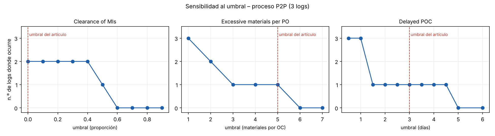

# Réplica: *Operational process monitoring: An object-centric approach*

Réplica experimental de:

> Park, G., & van der Aalst, W. M. P. (2025). Operational process monitoring: An object-centric approach.
> *Computers in Industry*, 164, 104170. https://doi.org/10.1016/j.compind.2024.104170 (Elsevier, acceso abierto CC BY-NC 4.0)

Este trabajo forma parte del curso **Propuesta de Investigación (2026-2), Ingeniería de Sistemas, Universidad de Lima**,
como apoyo a la tesis *"Detección de cuellos de botella mediante minería de procesos basada en hitos SCOR"*.

## Qué se replica

El artículo propone detectar **problemas operativos** (desviaciones e ineficiencias) en procesos con varios tipos de
objetos (requisición, orden de compra, material, recepción, factura). Cada problema se modela como un
**Grafo de Problema Operativo (OPG)**: una métrica centrada en objetos, un operador y un umbral.

Esta réplica **reimplementa desde cero, en Python puro**, las métricas de la Sección 5 del artículo
(`exist`, `non-exist`, `absent`, `h-cardinality`, `freq_avg`, `sojourn_avg`, `flow_avg`, `sync_avg`) y el monitoreo
de la Sección 6. No usa la aplicación web original (Docker + Redis + Celery), así que es fácil de ejecutar y auditar.

| Experimento | Qué hace | Equivale en el artículo |
|---|---|---|
| 1 | Monitorea 3 problemas en 3 logs del proceso **P2P (compras)** | Tabla 3 |
| 1b | Monitorea 4 problemas en 3 logs de **manufactura** | Tabla 2 |
| 2 | Calcula exactitud, precisión, recall y F1 frente a la columna *Reality* del artículo | (extensión) |
| 3 | Análisis de **sensibilidad al umbral** en P2P | Análogo a la Fig. 14 |
| 4 | Calcula los **valores de las métricas** en el log real **BPI Challenge 2017** (393 931 eventos) | Tabla 4 |

## Resultados

### Tabla 3 – Proceso P2P (compras)

| Problema | OPG | log1 (paper / réplica) | log2 | log3 |
|---|---|---|---|---|
| Clearance of MIs | h-cardinality₁(INVOICE, Clear Invoice) > 0 | ✓ / ✓ (0,60) | ✓ / ✓ (0,46) | ✗ / ✗ (0,00) |
| Excessive materials per PO | freq_avg(MATERIAL, Create PO) ≥ 5 | ✗ / ✗ (2,03) | ✗ / ✗ (1,92) | ✓ / ✓ (5,13) |
| Delayed POC | sojourn_avg(Create PO) ≥ 3 días | ✗ / ✗ (1,40 d) | ✗ / ✗ (1,40 d) | ✓ / ✓ (4,70 d) |

**9 de 9 celdas coinciden → exactitud = precisión = recall = F1 = 1,00.**

### Tabla 2 – Manufactura (secundario)

8 de 12 celdas coinciden (exactitud 0,67; precisión 1,00; recall 0,56). Las diferencias se explican en *Limitaciones*.

### Tabla 4 – Caso real BPI Challenge 2017 (valores de las métricas)

| Problema | Artículo | Réplica | Diferencia |
|---|---|---|---|
| Existence of CA | 0,3310 | 0,3310 | 0,0 % |
| APF precedes CA | 0,6690 | 0,6699 | 0,1 % |
| APF precedes CA (inmediatamente antes) | 0,6690 | 0,6690 | 0,0 % |
| CA with multiple offers | 0,2450 | 0,2450 | 0,0 % |
| High flow time of CA | 27 d 14:21:49 | 27 d 05:54:08 | −1,3 % |
| High sojourn time of CA | 24 d 23:09:35 | 25 d 12:44:44 | +2,3 % |
| High sync time of CA w.r.t. Offer | 2 d 00:23:45 | 1 d 17:09:24 | −15,0 % |
| High pooling time of CA w.r.t. Offer | 1 d 17:10:17 | 1 d 09:07:53 | −19,5 % |
| High readiness time of CA w.r.t. Offer | 00:25:44 | 08:01:03 | ver limitaciones |

Las métricas de proporción coinciden al 0,1 %. Las de tiempo de flujo y permanencia difieren menos de 2,5 %.

### Sensibilidad al umbral (P2P)



El número de logs donde se detecta cada problema cambia bruscamente en ciertos rangos de umbral
(p. ej., *Delayed POC* pasa de 3 a 1 log entre 1 y 1,5 días). Esto confirma la conclusión del artículo:
**el umbral debe elegirse con cuidado**.

Los CSV completos están en `results/`.

## Cómo ejecutar

Requisitos: Python ≥ 3.9. `matplotlib` es opcional (solo para la figura).

```bash
git clone https://github.com/JoaquinBernales/replica-park-vanderaalst.git
cd replica-park-vanderaalst
pip install -r requirements.txt
python data/descargar_datos.py        # descarga los logs OCEL publicados por los autores
python src/replicate.py               # ejecuta los 3 experimentos y escribe en results/
python tests/test_replica.py          # verifica que se reproduce la Tabla 3
```

Si `descargar_datos.py` falla, clona el repositorio original y copia los archivos a mano:
`git clone https://github.com/gyunamister/proact` → copia `samples/logs/p2p/p2p-log{1,2,3}.jsonocel` a `data/p2p/`
y `samples/logs/production/log{1,2,3}.jsonocel` a `data/production/`.

## Estructura

```
src/ocpm_metrics.py    métricas centradas en objetos y monitoreo de OPG (Def. 4-11 del artículo)
src/replicate.py       experimentos 1, 1b, 2, 3 y 4
data/                  script de descarga de los logs (no se redistribuyen: el repo original no tiene licencia)
results/               tablas CSV y figura generadas
tests/                 prueba automática de la Tabla 3
```

## Decisiones y limitaciones

1. **Fig. 12(a) vs. texto.** La figura dibuja *Clearance of MIs* sobre la actividad *plan goods issue*, pero esa
   actividad nunca involucra facturas en los logs (la métrica vale 0 en los tres logs). El texto del artículo define el
   problema sobre *"the event of clearing an invoice"*, así que se usó **Clear Invoice**. Con esa decisión los
   resultados coinciden al 100 %.
2. **Sojourn time.** Se implementó como `t(e) − max(t de los eventos habilitantes)`, siguiendo la Def. 8 y el ejemplo
   de la Fig. 5.
3. **Manufactura.** En los logs públicos de manufactura todos los eventos ocurren dentro de ~1 hora (tiempos
   comprimidos), por lo que *Delayed POR* (≥ 15 días) nunca se cumple. Además, ningún evento *Approve Purchase
   Requisition* incluye objetos RESERVATION, así que *absent* = 1,0 y *Absent reservation for PRA* (< 0,9) no se detecta.
   Esto sugiere que los archivos publicados no son exactamente los usados para la Tabla 2. Los otros dos problemas
   coinciden 6 de 6.
4. **Tabla 4, *APF precedes CA* (0,6699 vs. 0,6690).** El valor del artículo es igual a la proporción de solicitudes
   sin cancelación: no cuenta las 30 de 31 509 solicitudes donde *Assess potential fraud* ocurre antes de
   *Cancel application*, pero nunca inmediatamente antes. La Def. 5 dice "antes" (`precede`); si se mide
   "inmediatamente antes" (`directly_precede`), la réplica también da 0,6690. Ambas variantes están en el código.
5. **Tabla 4, métricas de tiempo con varios objetos.** *Sync*, *pooling* y *readiness* se calcularon con las
   fórmulas literales de la Def. 8, usando como eventos habilitantes el evento inmediatamente anterior de cada objeto
   (Def. 7). La herramienta original usa la librería `ocpa`, que puede construir esa relación de otra forma (por
   ejemplo, a partir del grafo de ejecución del proceso) o manejar distinto los empates de tiempo. Eso explica que
   las métricas que dependen de varios objetos difieran más que las de un solo objeto. Como el artículo no publica
   los umbrales de la Tabla 4, se comparan los valores de las métricas y no la columna ✓/✗.
6. **Estabilidad.** El cálculo es determinista (sin azar ni entrenamiento): `tests/test_replica.py` ejecuta el
   monitoreo 5 veces y comprueba que los resultados sean idénticos.
7. **Validación.** Como en el artículo, la "verdad" es la columna *Reality* reportada por los autores (los logs son
   simulados con problemas inyectados).

## Relación con la tesis

*Delayed POC* es exactamente el tipo de alerta que busca la tesis: el **tiempo de permanencia antes de un hito del
proceso de compras** comparado con un umbral. El siguiente paso es aplicar el mismo monitoreo a los hitos SCOR
(sS2.1 a sS2.5) sobre el dataset real **BPI Challenge 2019**.
